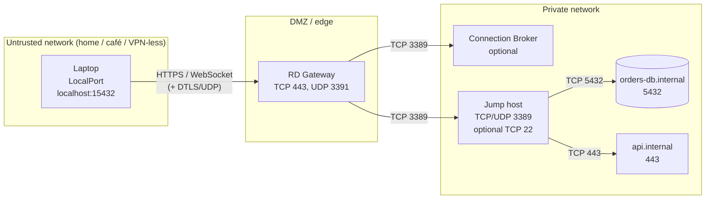
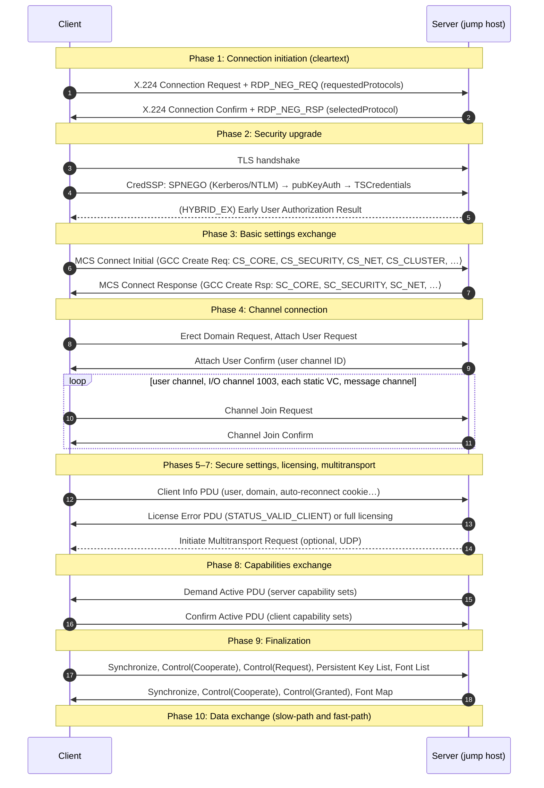
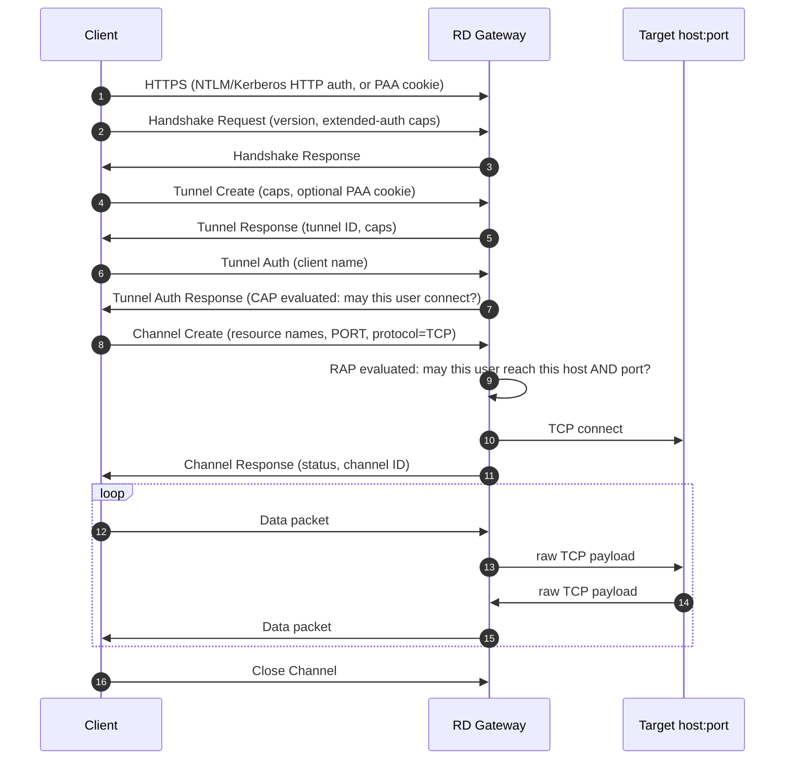
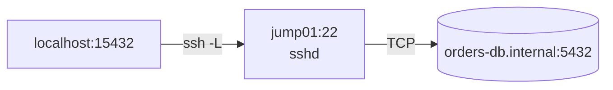
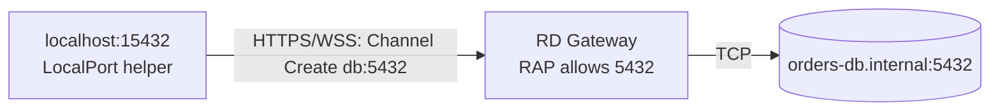
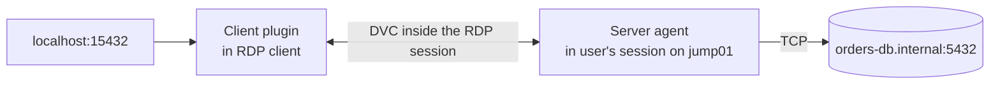

# RDP as a LocalPort Connection Technology: Network Model, Protocol, and Forwarding Options

> **Status:** exploration (branch `feature/rdp-exploration`). Nothing here is
> implemented yet. This document is the shared reference for choosing a design.

## Who this is for and what it answers

This tutorial is for engineers who know LocalPort's adapter model and want to
add **"reach a private database or web service through a Windows
remote-access machine"** as a supported technology. It answers three questions
in order:

1. **What does the network look like** when a remote-access machine sits
   between a developer laptop and private services? (Part 1)
2. **How does RDP actually work** on the wire, and what can and can't it carry?
   (Parts 2–4)
3. **What are the realistic ways** to make `localhost:<port>` on the laptop
   reach `db.internal:5432` through that machine, and how does each one fit
   LocalPort? (Parts 5–7)

### The one-paragraph answer

RDP is a remote *desktop* protocol. **It has no built-in TCP port forwarding**,
nothing like SSH's `-L`. Its extension mechanism, virtual channels, carries
clipboard, drives, audio, and so on, but no built-in channel forwards arbitrary
TCP. So "RDP support" in LocalPort really means **using the infrastructure
around RDP** (the jump host, the RD Gateway, or the cloud bastion that fronts
it) to carry a TCP stream. The cleanest options reuse transports that already
forward TCP: SSH on the jump host, a cloud bastion's native tunnel, or an RD
Gateway whose policy allows the target port. A custom virtual-channel tunnel
can be built but is the least robust option and the most sensitive to
governance. It is covered for completeness, at the architecture level.

---

## Part 1: The network model

### 1.1 Actors

| Actor | Typical name | Role |
|-------|--------------|------|
| **Client** | Developer laptop (macOS/Linux; LocalPort is Unix-only) | Runs LocalPort and the consuming app (psql, browser, IDE). |
| **RD Gateway** (optional) | `rdg.corp.example` | Internet-facing HTTPS endpoint that authenticates users and relays RDP into the private network. Windows Server role, speaks MS-TSGU. |
| **Connection Broker** (optional) | `rdcb.corp.example` | Load-balances or reconnects users across a farm of session hosts. Redirects the client to a specific host. |
| **Remote-access machine** | `jump01.corp.example` | A Windows Session Host / jump box inside the private network. It can reach the targets. |
| **Targets** | `orders-db.internal:5432`, `api.internal:443` | The services the developer actually wants. Not reachable from the laptop directly. |

Cloud variants swap the RD Gateway for a managed service: **Azure Bastion**,
**AWS Systems Manager (SSM) Session Manager / Fleet Manager**, or a vendor
privileged-access product. The topology is the same: a managed front door
followed by a host in the private network.

### 1.2 Topology and trust boundaries



Three facts about this picture drive every design decision later:

1. **The only inbound path from the laptop is the gateway's 443** (and
   possibly UDP 3391). The jump host's 3389 and the targets are not directly
   reachable.
2. **The gateway decides where a tunnel may go.** Its policies (CAP/RAP,
   §4.3) name which users may connect, to which hosts, and on which ports.
   Out of the box that is "port 3389 only."
3. **The jump host is the only machine with a route to the targets.**
   Whatever we build, the last hop (`jump01 → db:5432`) must originate on or
   behind the jump host.

### 1.3 Ports reference

| Port | Proto | Who listens | Purpose |
|------|-------|-------------|---------|
| 443 | TCP | RD Gateway | MS-TSGU over HTTPS (HTTP transport or WebSocket) |
| 3391 | UDP | RD Gateway | MS-TSGU UDP transport (DTLS), carries RDP-UDP |
| 3389 | TCP | Session host / jump host | RDP main connection |
| 3389 | UDP | Session host / jump host | RDP multitransport (MS-RDPEUDP), optional |
| 22 | TCP | Jump host (if OpenSSH Server enabled) | SSH, which supports `-L` forwarding |
| 5985/5986 | TCP | Jump host (if enabled) | WinRM (not a forwarding transport; listed so it's not mistaken for one) |

---

## Part 2: The RDP protocol stack

The normative reference is **[MS-RDPBCGR]** (Basic Connectivity and Graphics
Remoting). Everything in this part is summarized from it. Check details there
before implementing anything.

### 2.1 Layering

RDP is built on old ITU conferencing standards, which explains its odd
layering:

```text
┌─────────────────────────────────────────────────────────────┐
│  RDP PDUs: Client Info, Capabilities, Input, Graphics,      │
│            Virtual-channel data                             │
├─────────────────────────────────────────────────────────────┤
│  T.125 MCS: multipoint "domain", users, channels            │
│  T.124 GCC: conference create, carries settings blocks      │
├─────────────────────────────────────────────────────────────┤
│  X.224 (ISO 8073 class 0): connection request/confirm, data │
├─────────────────────────────────────────────────────────────┤
│  TPKT (RFC 1006): 4-byte length framing                     │
├─────────────────────────────────────────────────────────────┤
│  TLS 1.2/1.3 (+ CredSSP for NLA)  ← "Enhanced RDP Security" │
├─────────────────────────────────────────────────────────────┤
│  TCP 3389    (optionally + UDP 3389 via MS-RDPEUDP/RDPEMT)  │
└─────────────────────────────────────────────────────────────┘
```

Two consequences matter for us:

- **Everything after the first two PDUs is inside TLS.** A network device in
  the middle sees an X.224 handshake, then a TLS stream. That is why an RDP
  health check can only go as deep as the negotiation (§2.6) without
  credentials.
- **Multiplexing is native.** MCS gives every logical stream a channel ID, so
  graphics, input, clipboard, and every virtual channel share one TCP
  connection. This is the hook a virtual-channel tunnel would use (Part 3).

### 2.2 Connection sequence



### 2.3 Phase 1 in bytes: the negotiation

This is the only part of RDP visible without credentials. It's worth knowing
at the byte level because it lets LocalPort run a **protocol-aware RDP health
check** (§7.4).

Client → Server, 19 bytes, asking for TLS or CredSSP:

```text
03 00 00 13              TPKT: version 3, reserved, length 0x0013 (19)
0e e0 00 00 00 00 00     X.224 CR TPDU: LI=14, code=0xE0 (CR), dst-ref, src-ref, class 0
01 00 08 00 03 00 00 00  RDP_NEG_REQ: type=0x01, flags=0, length=8,
                         requestedProtocols=0x00000003 (SSL | HYBRID)
```

Server → Client, selecting CredSSP:

```text
03 00 00 13              TPKT
0e d0 00 00 12 34 00     X.224 CC TPDU: code=0xD0 (CC)
02 00 08 00 02 00 00 00  RDP_NEG_RSP: type=0x02, selectedProtocol=0x00000002 (HYBRID)
```

`requestedProtocols` / `selectedProtocol` flags:

| Value | Name | Meaning |
|-------|------|---------|
| `0x0` | `PROTOCOL_RDP` | Legacy "Standard RDP Security" (RC4). Should be disabled everywhere. |
| `0x1` | `PROTOCOL_SSL` | TLS, server authenticates with a certificate; user logs in at the remote login screen. |
| `0x2` | `PROTOCOL_HYBRID` | TLS + CredSSP = **Network Level Authentication (NLA)**. User is authenticated *before* a session is created. |
| `0x4` | `PROTOCOL_RDSTLS` | Used for redirected/reconnected sessions (e.g. broker, Azure AD). |
| `0x8` | `PROTOCOL_HYBRID_EX` | NLA + Early User Authorization Result PDU. |

If the server can't satisfy the request it returns `RDP_NEG_FAILURE`
(type `0x03`) with a reason code, for example `HYBRID_REQUIRED_BY_SERVER`.

An optional **routing token or cookie** (`Cookie: mstshash=<user>\r\n`) can
sit between the X.224 header and `RDP_NEG_REQ`. Load balancers and the
Connection Broker use it to pin a user to a host.

### 2.4 Phase 2: NLA via CredSSP

CredSSP ([MS-CSSP]) runs *inside* the TLS tunnel and exchanges ASN.1
`TSRequest` messages:

1. **SPNEGO tokens** (Kerberos if the client can get a ticket for
   `TERMSRV/jump01.corp.example`, else NTLM) authenticate the user.
2. **`pubKeyAuth`** binds that authentication to the server's TLS public key,
   which defeats a man in the middle who terminates TLS. Version 5+ hashes it
   with a client nonce, the fix for CVE-2018-0886.
3. **`TSCredentials`** delegates the user's credentials to the server so it
   can log them on.

**Why this matters for LocalPort:** any option that speaks RDP itself (rather
than reusing SSH or a cloud CLI) has to implement or embed TLS, SPNEGO,
Kerberos/NTLM, and CredSSP. That is a large surface, and a strong argument for
reusing an existing client (FreeRDP) or avoiding RDP entirely.

### 2.5 Phases 3–4: settings blocks and MCS channels

The GCC Conference Create Request carries client settings as typed blocks.
The one that matters here is **`CS_NET`**: the list of **static virtual
channels** the client wants. Each entry has an 8-byte name (7 ASCII chars plus
NUL) and option flags, with a maximum of **31** channels. The server answers in
**`SC_NET`** with the MCS channel ID assigned to each one.

Resulting channel map for a typical session:

| MCS channel ID | Channel | Carries |
|----------------|---------|---------|
| *(user ID)* | User channel | Server-to-specific-user traffic |
| `1003` | I/O channel (`MCS_GLOBAL_CHANNEL`) | Core RDP: capabilities, input, graphics |
| `1004…` | Static VCs in `CS_NET` order | `rdpdr`, `rdpsnd`, `cliprdr`, `drdynvc`, … |
| *(assigned)* | Message channel | Auto-detect, multitransport bootstrapping |

Static channels are **fixed at connect time**. You cannot add one mid-session.
That is why dynamic channels exist (§3.2).

### 2.6 Phase 10: slow-path vs fast-path

- **Slow-path** PDUs carry the full TPKT → X.224 Data → MCS Send Data →
  Share Data header stack.
- **Fast-path** PDUs drop most of that: the first byte flags them as
  fast-path, followed by a short length and the payload. Input and graphics
  updates use fast-path for latency.

Virtual-channel data always goes through **MCS Send Data** on its channel ID
(slow-path framing), wrapped in a `CHANNEL_PDU_HEADER` (§3.1).

### 2.7 Multitransport (UDP)

After the TCP connection is up, the server may offer UDP via **[MS-RDPEUDP]**
(a reliable or lossy transport over UDP 3389) with **[MS-RDPEMT]** running TLS
or DTLS on top. Graphics and some dynamic virtual channels can move to UDP;
the TCP connection stays as the control path. Through an RD Gateway, UDP
travels as DTLS on gateway port 3391.

For our purposes UDP is a performance detail. The TCP path always works, and
a tunnel design must not depend on UDP being available.

---

## Part 3: Virtual channels, RDP's extension point

### 3.1 Static virtual channels (SVC)

- Declared in `CS_NET`, joined in Phase 4, live for the whole connection.
- Data is split into chunks (default `CHANNEL_CHUNK_LENGTH` = **1600 bytes**),
  each prefixed with a `CHANNEL_PDU_HEADER`:

  ```text
  length      (4 bytes)  total uncompressed length of the whole message
  flags       (4 bytes)  CHANNEL_FLAG_FIRST 0x01 | CHANNEL_FLAG_LAST 0x02 |
                         CHANNEL_FLAG_SHOW_PROTOCOL 0x10 | compression bits
  ```

- Bidirectional once joined. Either endpoint may send.
- Well-known SVCs: `rdpdr` (device redirection: drives, smart cards,
  printers, serial and parallel ports), `rdpsnd` (audio output), `cliprdr`
  (clipboard), `rail` (RemoteApp), and `drdynvc` (the carrier for dynamic
  channels).

### 3.2 Dynamic virtual channels (DVC)

[MS-RDPEDYC] layers many dynamic channels on top of the single `drdynvc` SVC,
which removes the 31-channel and connect-time limits.

Each DVC PDU begins with a one-byte header:

```text
bit  7 6 5 4   3 2   1 0
     ───────   ───   ───
       Cmd      Sp   cbId     cbId = width of the ChannelId field (1, 2, or 4 bytes)
                              Sp   = width of a following length field (DataFirst/Create)
```

| Cmd | PDU | Direction |
|-----|-----|-----------|
| `0x05` | Capabilities Request / Response | server → client, then client → server |
| `0x01` | **Create Request** / Create Response | **server → client**, then client → server |
| `0x02` | Data First (carries total length) | either way |
| `0x03` | Data | either way |
| `0x04` | Close Request / Response | either way |
| `0x06`/`0x07` | Data First / Data, compressed (v3) | either way |
| `0x08`/`0x09` | Soft-Sync Request / Response (move to UDP) | server → client, then client → server |

**The design-critical fact: DVC creation is server-initiated.** The server
side (an application on the session host calling `WTSVirtualChannelOpenEx`
with `WTS_CHANNEL_OPTION_DYNAMIC`) sends Create Request with a channel name.
The client side (a plugin implementing `IWTSPlugin`/`IWTSListener` in `mstsc`,
or a FreeRDP channel add-in) accepts or refuses it. The client **cannot** open
a channel on its own.

Built-in DVCs include graphics pipeline (`Microsoft::Windows::RDS::Graphics`),
input, display control, camera, USB (RemoteFX), and audio input. None of them
forward TCP.

### 3.3 What the built-in channels can and cannot do for us

| Need | Built-in RDP? | Notes |
|------|---------------|-------|
| See the jump host desktop | ✅ | The core purpose of RDP. |
| Copy a connection string to the jump host | ✅ `cliprdr` | Manual, not a forward. |
| Mount the laptop's disk on the jump host | ✅ `rdpdr` | Wrong direction and wrong layer. |
| Make `localhost:15432` reach `db.internal:5432` | ❌ | **No built-in channel does this.** |

This is the central finding. Every option in Part 5 either uses a transport
other than RDP or adds custom software at both ends of an RDP session.

---

## Part 4: RD Gateway (MS-TSGU)

The RD Gateway is the piece most organizations actually expose to the
internet, so it deserves its own part. Reference: **[MS-TSGU]**.

### 4.1 Transports

| Transport | How | Notes |
|-----------|-----|-------|
| RPC-over-HTTP | Legacy DCE/RPC tunnel | Old clients only. Ignore. |
| **HTTP transport** | Two long-lived HTTPS requests with custom methods, `RDG_OUT_DATA` (server → client) and `RDG_IN_DATA` (client → server), correlated by an `RDG-Connection-Id` header | The common case. |
| **WebSocket** | `RDG_OUT_DATA` with `Upgrade: websocket`, one full-duplex connection | Preferred by modern clients and friendlier to proxies. |
| **UDP transport** | DTLS on 3391 | Carries RDP-UDP only. Supplements HTTP. |

### 4.2 The HTTP-transport packet flow



**The detail that matters:** the **Channel Create** packet names a target host
and a **port**. The gateway is, mechanically, a *policy-gated TCP relay*. It
does not inspect the stream to check that it's RDP. What restricts it to RDP is
**policy**, not protocol.

### 4.3 Gateway policy: CAP and RAP

- **CAP (Connection Authorization Policy):** *who* may use the gateway: user
  and computer groups, smart-card requirement, device-redirection settings,
  idle and session timeouts.
- **RAP (Resource Authorization Policy):** *what* they may reach: a computer
  group (or "any network resource") **and an allowed-ports list**. The default
  is **3389 only**. An administrator can allow specific additional ports, or any
  port.

So whether the gateway can carry `db.internal:5432` is not a protocol question.
It is a **policy decision owned by the gateway administrators**. If the RAP
doesn't allow the port, the Channel Response returns an error and nothing
connects. That is the correct, intended behavior, and LocalPort must surface
it clearly rather than work around it.

### 4.4 Authentication modes we would have to support

| Mode | Where seen | Implementation burden |
|------|-----------|-----------------------|
| NTLM over HTTP | On-prem, non-domain clients | Moderate (well-understood, libraries exist) |
| Kerberos (SPNEGO/Negotiate) over HTTP | Domain-joined or `kinit`-capable clients | Moderate (GSSAPI on macOS/Linux) |
| Smart card | High-assurance environments | High |
| PAA cookie (pre-authenticated) | Entra ID / Azure AD App Proxy, some VDI brokers | High: requires the identity provider's web flow |

---

## Part 5: Options for making a local port reach a private service

Each option below has the same shape: **data path**, **prerequisites**,
**who must approve**, **LocalPort fit**, and **risks**. They are ordered from
most to least recommended.

### Option A: SSH on the jump host (reuse the existing SSH adapter)

Windows 10 1809+ and Windows Server 2019+ ship **OpenSSH Server** as an
optional feature. It supports standard local forwarding
(`AllowTcpForwarding yes` is the upstream default).



- **Prerequisites:** sshd enabled on the jump host. Port 22 reachable from the
  laptop *or* through another path (see A′). Keys provisioned.
- **Approval:** jump-host owners (enable sshd, decide on forwarding).
- **LocalPort fit:** **already supported, with zero code.** This is the
  existing `technology: ssh` with `remote_host`:

  ```yaml
  - name: orders-db
    technology: ssh
    local_port: 15432
    remote_port: 5432
    connection:
      host: jump01.corp.example
      user: svc-localport
      key_file: ~/.ssh/jump01_ed25519
      remote_host: orders-db.internal
  ```

- **Risks:** organizations that standardized on RDP sometimes refuse to run
  sshd on Windows. Port 22 is often not exposed at the edge.

#### Option A′: SSH carried through the RD Gateway

If the edge exposes only the gateway, the gateway's RAP can allow **port 22 on
the jump host**. The SSH adapter then runs with a `ProxyCommand` helper that
opens one MS-TSGU channel to `jump01:22` (Option C's machinery, scoped to a
single port), and SSH does the rest. Admins approve one narrow rule (port 22
on one host) instead of a rule per database.

### Option B: Cloud bastion native tunnels

If the remote-access machine lives behind a managed cloud front door, that
service usually offers a supported TCP tunnel CLI. LocalPort runs it as a
subprocess, exactly like `kubectl port-forward`.

| Service | Command shape | Reaches |
|---------|---------------|---------|
| **AWS SSM** | `aws ssm start-session --target i-0abc… --document-name AWS-StartPortForwardingSessionToRemoteHost --parameters host=orders-db.internal,portNumber=5432,localPortNumber=15432` | **Any host the instance can reach.** A direct analog of `ssh -L`. Requires `session-manager-plugin`. |
| **Azure Bastion** | `az network bastion tunnel --name <bastion> --resource-group <rg> --target-resource-id <vm-id> --resource-port <port> --port <local>` | A port on the target VM (or a private IP with IP-based connection, Standard/Premium SKU with native-client support). To reach a DB *behind* the VM, chain it with SSH (tunnel to VM:22, then Option A). |

- **Prerequisites:** cloud CLI installed and logged in. IAM/RBAC permission to
  start sessions. Agent (SSM) or SKU (Bastion) configured.
- **Approval:** cloud-platform owners, through ordinary IAM.
- **LocalPort fit:** **excellent.** A long-lived subprocess with a PID and
  stdout/stderr logs maps 1:1 onto `PortForwardingAdapter`.
  `get_required_tools()` returns `["aws", "session-manager-plugin"]` or
  `["az"]`.
- **Risks:** cloud CLI token expiry (sessions die when credentials expire, and
  the restart loop needs a clear "re-login required" error rather than
  thrashing). Per-vendor flag drift.

### Option C: RD Gateway as a policy-gated TCP relay

Implement an MS-TSGU HTTP/WebSocket client that sends **Channel Create** for
`orders-db.internal:5432` directly, then splices a local TCP listener onto the
channel's Data packets.



No jump host is involved: the gateway itself is the last-hop relay.

- **Prerequisites:** gateway RAP that explicitly allows the target host and
  port for the developer's group.
- **Approval:** **gateway administrators, explicitly.** This works only if
  they add the port to the RAP. That is a feature: the policy stays the single
  source of truth for who can reach what.
- **LocalPort fit:** good, as a **helper subprocess**
  (`localport-rdg-proxy --gateway … --target host:port --listen 127.0.0.1:15432`)
  so the adapter keeps the PID-based contract. One gateway tunnel per service,
  or one tunnel with multiple channels.
- **Risks / effort:** the largest build effort among the clean options. We'd
  implement MS-TSGU framing, NTLM/Kerberos HTTP auth (and possibly PAA
  cookies), reconnect, and keepalives. Many organizations will reasonably
  decline to open non-RDP ports on the RAP, so this option's reach depends on
  the policy conversation.

### Option D: Custom virtual-channel tunnel inside an RDP session (last resort)

Architecturally possible, because virtual channels are generic byte pipes,
but it is the most fragile and most governance-sensitive option.



What it would take, at the architecture level:

1. **Server-side agent** running *inside the user's interactive session* on
   the jump host. Because DVC creation is server-initiated (§3.2), the agent
   must open a control channel when the session starts.
2. **Client-side plugin** loaded by the RDP client (a FreeRDP channel add-in;
   `mstsc` is Windows-only and irrelevant for our macOS/Linux users). It
   accepts that channel, listens on the local port, and multiplexes local
   connections over the channel with a small stream-ID framing.
3. **A live, logged-on RDP session**, kept alive for as long as the forward is
   needed.

Why this is last:

- **Coupled lifecycles.** The forward dies with the RDP session. Idle and
  disconnect timeouts in the gateway CAP and the session-host GPO will tear it
  down. LocalPort would have to supervise a full RDP client (likely headless
  FreeRDP) plus an agent it doesn't control.
- **Software on the jump host.** It needs installation, code signing, and
  endpoint-security allow-listing on a machine we don't own.
- **Governance.** It opens a network path that the gateway's RAP and the
  network's segmentation **cannot see or enforce**. Remote-access owners treat
  that as a policy bypass, and endpoint security commonly flags it. **We should
  pursue this only with explicit written approval from the owners of the
  remote-access environment**, and only where Options A–C have been ruled out
  for documented reasons.
- **Poor process-model fit.** There's no single PID that means "the forward is
  up."

### Option E: Things that look like options but aren't

| Idea | Why it doesn't solve the problem |
|------|----------------------------------|
| `netsh interface portproxy` on the jump host | Exposes `jump01:15432 → db:5432`, but the laptop still can't reach `jump01:15432`. The edge only allows 443. Useful only *combined* with A′ or C. |
| Apache Guacamole / HTML5 RDP gateways | Browser-side RDP rendering. No TCP forwarding. |
| RDP drive or clipboard redirection | Moves files and text, not sockets. |
| Running the client app on the jump host | Works, but it's "use the desktop," not a LocalPort forward. Worth naming as the zero-engineering fallback. |

---

## Part 6: Comparison

| | A: SSH on jump | A′: SSH via RDG | B: Cloud bastion | C: RDG relay | D: VC tunnel |
|---|---|---|---|---|---|
| **New LocalPort code** | None | Small helper (one MS-TSGU channel) | One subprocess adapter per vendor | Full MS-TSGU client helper | RDP client supervision + plugin + agent |
| **Software on jump host** | sshd (built in) | sshd | Cloud agent (often preinstalled) | None | Custom agent |
| **Policy change needed** | Enable sshd, open 22 | RAP: allow 22 on jump | IAM grant | RAP: allow each target port | Approval to bypass gateway policy |
| **Who enforces access** | sshd + network | RAP + sshd | Cloud IAM | RAP | **Nobody** (invisible to gateway) |
| **Fits PID adapter model** | ✅ | ✅ | ✅ | ✅ (helper) | ⚠️ |
| **Survives RDP session timeout** | n/a | n/a | n/a | n/a | ❌ |
| **Reach of each forward** | Anything jump reaches | Anything jump reaches | AWS: anything; Azure: target VM | Whatever RAP allows | Anything jump reaches |
| **Recommendation** | **First choice** | **First choice where 22 isn't exposed** | **First choice in cloud** | Viable with admin buy-in | Avoid unless sanctioned |

---

## Part 7: Fitting the chosen option(s) into LocalPort

### 7.1 Where a new technology touches the code

Adding a `ForwardingTechnology` today touches these places (found by tracing
the existing `ssh` branches):

| Layer | File | Change |
|-------|------|--------|
| Domain | `domain/enums.py` | Add enum value(s), e.g. `AWS_SSM`, `RDGATEWAY`. |
| Domain | `domain/value_objects/connection_info.py` | Factory classmethod, `_validate_*_config`, typed getters. Keep runtime checks (credential files, CLI login) **out of** parse-time validation. Today a missing SSH key file raises during config load and breaks `localport status` for every service. Don't repeat that. |
| Domain | `domain/entities/service.py` | Deterministic-ID config key: include the fields that identify the forward (gateway, target host, instance ID, …). |
| Infra | `infrastructure/adapters/<new>_adapter.py` | Implement `PortForwardingAdapter`. |
| Infra | `infrastructure/adapters/adapter_factory.py` | `register_adapter(...)`. |
| Infra | `infrastructure/repositories/yaml_config_repository.py` | Parse the new `connection:` block. |
| App | `application/services/service_manager.py` | Adapter map entry. Check the SSH-specific branch near line 389 for analogous behavior. |
| App | `application/services/connection_validation_service.py`, `application/use_cases/add_connection.py`, `list_connections.py`, `application/dto/connection_dto.py` | Validation and `config add` support. |
| CLI | `cli/commands/config_commands.py`, `cli/formatters/format_router.py`, `cli/formatters/connection_formatter.py` | `config add --technology …`, status rendering. |
| Docs | `docs/configuration.md` | Connection reference for the new block. |

That's roughly a dozen files per technology, which is an argument for
**preferring Option A** (zero files) and, if we add B or C, for considering a
small generic "subprocess tunnel" adapter that the vendor-specific options
share.

### 7.2 Configuration sketches (proposed, not implemented)

```yaml
# Option B: AWS SSM to a remote host
- name: orders-db
  technology: aws_ssm
  local_port: 15432
  remote_port: 5432
  connection:
    target: i-0abc1234def567890
    remote_host: orders-db.internal
    profile: corp-dev          # optional AWS profile
    region: us-east-1          # optional

# Option C: RD Gateway relay
- name: orders-api
  technology: rdgateway
  local_port: 18443
  remote_port: 443
  connection:
    gateway: rdg.corp.example
    remote_host: api.internal
    auth: kerberos             # kerberos | ntlm
    username: ${RDG_USER}      # env substitution, no secrets in YAML
    password: ${RDG_PASSWORD}  # ntlm only
```

Note the deliberate reuse of `remote_host` from the SSH block so "where the
traffic finally goes" reads the same across technologies.

### 7.3 Process model and restart semantics

- Options A, A′, B, and C are all **one long-lived subprocess per service**,
  which is exactly what the `HealthMonitorScheduler` and restart manager
  already supervise.
- Map **authentication-expired** failures (SSM token, Kerberos ticket, gateway
  `REAUTH_MESSAGE`) to a distinct, non-retrying error state. Otherwise the
  restart loop thrashes against an identity provider and can lock the account.
- Gateway and bastion idle timeouts close quiet tunnels. Use protocol
  keepalives (MS-TSGU Keepalive packets, SSH `ServerAliveInterval`, which the
  SSH adapter already sets) rather than synthetic traffic.

### 7.4 Health checks

- The existing **`tcp`** check on `localhost:<local_port>` only proves the
  local listener is up. For B and C the listener can be up while the far side
  is down.
- The existing **`postgres`** / **`http`** checks go end-to-end and are the
  right default for databases and web services.
- A possible **`rdp`** check type (useful for monitoring the jump host itself):
  send the 19-byte `RDP_NEG_REQ` from §2.3, expect an X.224 Connection Confirm
  with `RDP_NEG_RSP` or `RDP_NEG_FAILURE`, then close. It needs no credentials
  and creates no session.

---

## Part 8: Security and governance checklist

- **Authorization first.** Every option assumes the developer is authorized to
  reach the target service and that the remote-access owners have approved
  the path. LocalPort should make the path *convenient*, never *possible where
  it wasn't*.
- **Policy stays at the front door.** Prefer options where an existing control
  (sshd config, RAP, cloud IAM) decides reachability (A, A′, B, C) over ones
  that hide traffic from it (D).
- **Bind to loopback.** Forwards listen on `127.0.0.1` by default, as LocalPort
  already does. A gateway forward bound to `0.0.0.0` turns the laptop into a
  bridge into the private network.
- **No secrets in YAML.** Use env substitution and OS keychains. Never log
  gateway passwords or PAA cookies. The SSH adapter's `has_password` pattern
  is the model.
- **Certificate validation.** The RD Gateway client (Option C) must validate
  the gateway's TLS certificate. Don't copy the SSH adapter's
  `StrictHostKeyChecking=no` habit into a new adapter.

---

## Part 9: Questions for the working session

1. **What is actually deployed in front of the target environments?** On-prem
   RD Gateway, Azure Bastion, AWS SSM, or a vendor PAM product? This decides
   between A′, B, and C more than any technical argument.
2. **Will the jump-host owners enable OpenSSH Server?** If yes, Option A ships
   today with documentation only.
3. **Will the gateway owners add RAP rules?** Port 22 on the jump host (A′) is
   a much smaller ask than per-database ports (C).
4. **Which auth modes must the first version support?** Kerberos-only is far
   cheaper than also supporting NTLM, smart cards, and PAA.
5. **Do we want a generic subprocess-tunnel adapter** so B-style vendor CLIs
   become configuration rather than code?
6. **Is Option D off the table?** Recommendation: record it as rejected in
   `design-decisions.md` unless a sanctioned use case appears.

---

## References

- **[MS-RDPBCGR]** Remote Desktop Protocol: Basic Connectivity and Graphics Remoting
- **[MS-RDPEDYC]** Remote Desktop Protocol: Dynamic Channel Virtual Channel Extension
- **[MS-CSSP]** Credential Security Support Provider (CredSSP) Protocol
- **[MS-TSGU]** Terminal Services Gateway Server Protocol
- **[MS-RDPEUDP]** / **[MS-RDPEMT]** RDP UDP Transport / Multitransport Extension
- ITU-T **T.124** (GCC), **T.125** (MCS); **X.224**; IETF **RFC 1006** (TPKT)
- Microsoft Learn: *OpenSSH for Windows*; *RD Gateway: Connection and Resource Authorization Policies*
- Microsoft Learn: *Azure Bastion: Connect to a VM using the native client* (`az network bastion tunnel`)
- AWS Docs: *Session Manager: port forwarding to remote hosts* (`AWS-StartPortForwardingSessionToRemoteHost`)
- FreeRDP project documentation: channel add-ins (client-side virtual-channel plugins)

Protocol constants in this document come from the Microsoft Open Specifications
above. Check them against the current revision of each spec before writing
code against them.
